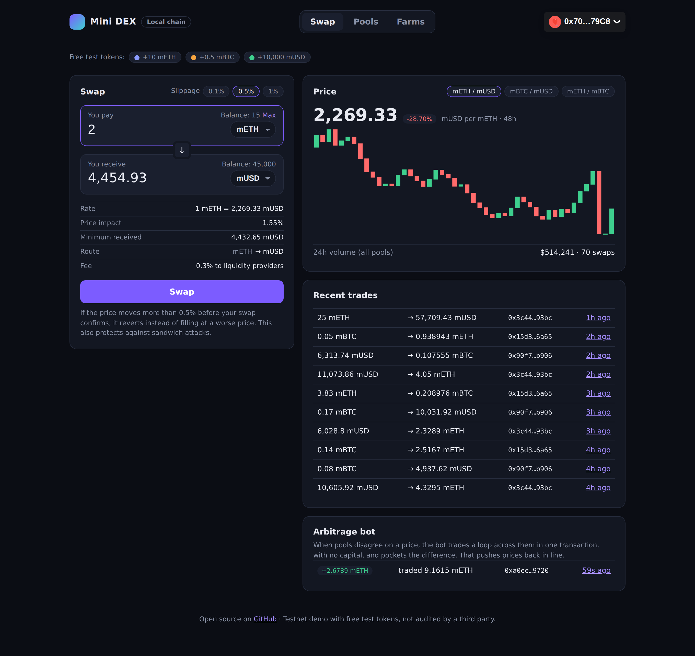
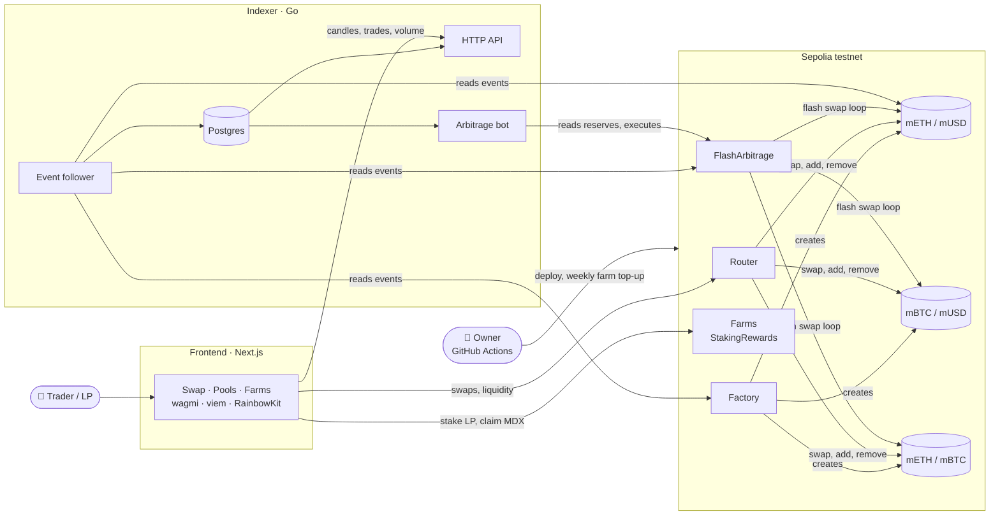

# Mini DEX

[](https://github.com/rajdama/mini-dex/actions/workflows/contracts.yml)
[](https://github.com/rajdama/mini-dex/actions/workflows/frontend.yml)
[](https://github.com/rajdama/mini-dex/actions/workflows/indexer.yml)


A decentralized exchange built from scratch: **swap tokens, provide liquidity to earn trading fees,
farm rewards with your LP tokens**, plus a Go backend with an indexer and an **arbitrage bot that
trades with zero capital using flash swaps**.

Solidity contracts (constant-product AMM in the style of Uniswap V2), a Next.js dApp, and a Go
service, all tested end to end on every push.

> **Live demo:** coming soon on the Sepolia testnet ([how it gets deployed](#deploying-it-yourself)).
> Free test tokens, no real money.



*The swap screen from the full-stack demo: a quote with price impact and slippage protection, hourly
price candles and trades from the indexer, and the arbitrage bot's latest trade.*

## What is this, in simple words?

A DEX lets people trade tokens without a company in the middle. Instead of an order book, each
**pool** holds two tokens, and a formula sets the price:

- A pool holds, say, 100 ETH and 300,000 USD. Their product, **x × y = k**, must never go down.
- To buy ETH you add USD; the pool gives you as much ETH as it can while keeping the product
  constant. The bigger your trade compared to the pool, the worse your price (**price impact**).
- Every trade pays a **0.3% fee**, which stays in the pool. **Liquidity providers** who deposited
  both tokens own a share of the pool through **LP tokens**, so the fees grow their share's value.
- LP tokens can be staked in a **farm** to earn extra **MDX** reward tokens, the "liquidity mining"
  many DeFi projects use to attract liquidity.
- When pools disagree on a price, an **arbitrage bot** trades a loop across them and keeps the
  difference. That's what keeps prices consistent everywhere.

| Term | Meaning |
|---|---|
| **Pool / pair** | A contract holding two tokens that people trade against |
| **Liquidity provider (LP)** | Someone who deposits both tokens of a pool to earn fees |
| **LP token** | Your receipt for a share of a pool; redeem it for your share of both tokens |
| **Price impact** | How much your own trade moves the price against you |
| **Slippage tolerance** | How much worse than the quote you'll accept before the trade cancels itself |
| **Flash swap** | Receive tokens first and pay for them later in the same transaction |
| **Arbitrage** | Profiting from price differences between pools, which also fixes them |

## Features

**Smart contracts** ([`contracts/`](contracts))
- Constant-product pools with a 0.3% LP fee, LP tokens, flash swaps and a TWAP price oracle
- Factory that deploys pools at predictable addresses (CREATE2)
- Router with slippage limits, deadlines, multi-hop swaps and liquidity at the pool ratio
- Flash-swap arbitrage contract that trades a loop of pools with no starting capital
- Farms that pay MDX for staked LP tokens, with lock boosts up to 3x (reused from
  [staking-rewards](https://github.com/rajdama/staking-rewards))
- Protection against sandwich, inflation, reentrancy and *read-only* reentrancy attacks, all tested

**dApp** ([`frontend/`](frontend))
- Swap with automatic best route (direct or through a third token), price impact and slippage settings
- Add and remove liquidity at the pool ratio, see your share and the pool's value
- Farm LP tokens with lock boosts, rewards ticking up live
- Price candles, 24h volume, recent trades and arbitrage activity from the indexer
- Free test-token faucet, works read-only without a wallet

**Backend** ([`indexer/`](indexer))
- Go indexer that discovers new pools from the factory and stores every swap, liquidity change,
  price update and arbitrage in Postgres
- JSON API: pool stats with 24h volume, hourly candles, trades and arbitrage history
- **Arbitrage bot**: finds the most profitable three-pool loop, sizes the trade for maximum profit,
  and executes it through the flash-arbitrage contract

## Architecture



The contracts are the source of truth: the dApp quotes and trades directly against the chain and
uses the indexer only for history. If the indexer is down, trading still works.

## How it works

### The pricing formula

For a pool with reserves `x` and `y`, a trade of `dx` returns:

```
dy = dx × 0.997 × y / (x + dx × 0.997)
```

The pair contract doesn't trust this math from the caller. It sends the output first (which is what
makes flash swaps possible), then checks that, after charging 0.3% on what came in, the product of
its balances is at least what it was before. If not, the whole transaction reverts.

**Example:** a pool with 100 ETH and 300,000 USD. Selling 1 ETH returns 2,961.47 USD: 3,000 at the
current price, minus the 0.3% fee and about 1% price impact.

### Liquidity

The first deposit sets the price and mints `√(x × y)` LP tokens, of which **1,000 are locked
forever**. Later deposits get LP tokens in proportion to what they add; adding off-ratio only counts
the smaller side, so nobody can shift the price for free.

### Arbitrage with zero capital

Say a whale sells ETH into the ETH/USD pool, so ETH is cheaper there than the ETH/BTC and BTC/USD
pools imply. The loop **USD → ETH → BTC → USD** now returns more USD than it starts with. The bot:

1. Reads all reserves and checks every three-pool loop in both directions.
2. Finds the trade size with maximum profit. Profit rises then falls with size (each unit moves the
   price further), so a ternary search converges on the peak.
3. Calls `FlashArbitrage.execute`, which flash-borrows the first hop's output, trades the rest of
   the loop, repays the first pool, and sends the profit to the bot, all in one transaction.

In the end-to-end demo, after a 25 ETH dump the bot traded 9.16 mETH around the loop and kept
**2.68 mETH of profit** (a 29% return, because the dump moved prices a lot), with no starting
balance.

## Results

All numbers come from this repo's GitHub Actions runs.

### Tests

| Check | Result |
|---|---|
| Tests | 115 passing: unit, fuzz, invariant, attack scenarios, deploy scripts |
| Coverage | 100% lines, statements, branches and functions, every contract |
| Invariants | 4 properties × 25,600 random calls: swaps, multi-hop swaps, liquidity changes, donations, arbitrage |
| Slither | 0 high, 0 medium |
| Go indexer | All packages pass, including Postgres integration tests |
| End to end | 48 hours of seeded trading, the indexer and bot running, real swaps through the browser |

### Security

See **[AUDIT.md](AUDIT.md)** for the full review. Highlights:

| Attack | Defense | Result |
|---|---|---|
| Sandwich attack | Router `amountOutMin` from the slippage setting | Blocked; without it the victim loses 29% |
| First-depositor inflation | 1,000 LP locked on the first deposit | Attacker recovers under 0.1% of the donation |
| Reentrancy during a flash swap | OpenZeppelin `ReentrancyGuard` | Reverts |
| Read-only reentrancy | `getReserves()` reverts while a swap is in progress | Reverts (goes beyond Uniswap V2) |
| Spoofed arbitrage callback | Callback checks its caller and who started the swap | Reverts |

### Gas

| Action | Gas |
|---|---|
| Swap, one pool | ~115k |
| Swap, two pools | ~164k |
| Remove liquidity | ~145k |
| Arbitrage, three-pool flash loop | ~282k |
| Stake LP in a farm | ~215k |
| Create a new pool | ~1.76M (one time) |

## Repository structure

```
contracts/                Foundry project
  src/core/                 Pair (pool + LP token) and Factory
  src/periphery/            Router, DexLibrary (price math), FlashArbitrage
  src/farm/                 StakingRewards (liquidity mining)
  src/tokens/               FaucetToken for testnet tokens
  test/                     unit, fuzz, invariant and attack tests
  script/                   Deploy and RenewFarms
frontend/                 Next.js dApp
indexer/                  Go indexer, API and arbitrage bot
scripts/demo/             seeds a local chain with trading history, takes screenshots
.github/workflows/        CI for each part, deploy, weekly farm renewal, full-stack demo
AUDIT.md                  self-audit report
```

## Running locally

```bash
# Contracts
cd contracts
forge test

# Local chain with 48 hours of trading history
anvil --timestamp $(( $(date +%s) - 48*3600 )) &
../scripts/demo/seed.sh

# Indexer and bot (needs Postgres)
cd ../indexer
cp .env.example .env    # fill in from contracts/deployments/31337.json
go run ./cmd/indexer

# Frontend (reads contract addresses from contracts/deployments/<chainId>.json)
cd ../frontend
NEXT_PUBLIC_CHAIN_ID=31337 NEXT_PUBLIC_RPC_URL=http://127.0.0.1:8545 \
NEXT_PUBLIC_INDEXER_URL=http://127.0.0.1:8080 npm run dev
```

### Indexer API

| Endpoint | Returns |
|---|---|
| `GET /api/stats` | Pools, swaps (total and 24h), liquidity events, arbitrages, last indexed block |
| `GET /api/pairs` | Each pool's reserves and 24h volume |
| `GET /api/pairs/{address}/candles?limit=48` | Hourly price candles, gaps filled with the previous close |
| `GET /api/swaps?limit=20&pair=` | Latest user trades (multi-hop hops and bot trades left out) |
| `GET /api/arbitrage?limit=10` | Latest arbitrage trades and profits |

## Deploying it yourself

1. **Wallet:** create a fresh wallet for deployment only and get Sepolia ETH from a faucet.
2. **Accounts:** get a Sepolia RPC URL (for example Alchemy) and an Etherscan API key.
3. **Secrets:** in *Settings → Secrets and variables → Actions*, add `DEPLOYER_PRIVATE_KEY`,
   `SEPOLIA_RPC_URL` and `ETHERSCAN_API_KEY`.
4. **Deploy:** run the **deploy** workflow from the *Actions* tab. It deploys and verifies all
   contracts, seeds three pools at consistent prices, starts the farms, and commits the addresses to
   `contracts/deployments/11155111.json`. The **renew farms** workflow tops up rewards every Monday.
5. **Frontend:** import the repo on Vercel with root directory `frontend`; it reads the addresses
   from the deployment file automatically. Set `NEXT_PUBLIC_WALLETCONNECT_PROJECT_ID`, and
   `NEXT_PUBLIC_INDEXER_URL` once the indexer is up.
6. **Indexer and bot:** deploy `indexer/` (it has a Dockerfile) on a host such as Railway with
   Postgres. Set `BOT_PRIVATE_KEY` to a separate wallet with a little Sepolia ETH for gas to run the bot.

## Tech stack

Solidity 0.8.24 · Foundry · OpenZeppelin v5 · Slither · Next.js 14 · TypeScript · wagmi · viem ·
RainbowKit · TanStack Query · Go 1.22 · go-ethereum · pgx · Postgres · GitHub Actions · Playwright

---

*AMM design follows Uniswap V2's constant-product model; the contracts are an independent
implementation with additional protections.*
